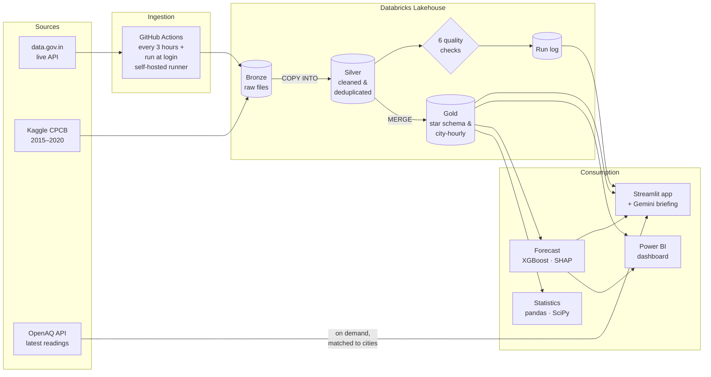

<div align="center">

# AQI India Data Platform

**An end-to-end platform that collects, cleans, analyses, and forecasts air quality for Indian cities.**

[](https://aqi-india-platform.streamlit.app/)


**[Open the live app →](https://aqi-india-platform.streamlit.app/)**

</div>

---

## Table of contents

- [Overview](#overview)
- [Key results](#key-results)
- [Architecture](#architecture)
- [Features](#features)
- [Data quality](#data-quality)
- [Tech stack](#tech-stack)
- [Repository structure](#repository-structure)
- [Getting started](#getting-started)
- [Data sources](#data-sources)
- [Limitations](#limitations)

---

## Overview

Air pollution is one of India's most serious public health problems, yet most people only see a single number for today, after the air has already turned unhealthy.

This project builds a complete data platform to answer three questions:

1. **Where and when** is India's air worst, and which pollutants drive it?
2. **Can people be warned a day in advance** before unhealthy air arrives?
3. **Can the data be trusted**, given that government sensor data contains gaps and errors?

It combines five years of historical data (2015–2020, 26 cities) with a **live feed** from 550+ government monitoring stations in 270+ cities. A scheduled pipeline stores and quality-checks the data, and the app additionally fetches the **latest readings on demand** through OpenAQ, so it shows near-current air quality at any time.

---

## Key results

| Area | Result |
|---|---|
| **Forecasting** | XGBoost next-day model for Delhi warned of **96% of unhealthy days** (187 of 194) in 2019 and reduced missed warnings by **77%** (30 → 7) compared with a naive baseline |
| **Health exposure** | In 2019, PM2.5 exceeded India's safe limit on **71% of days in Lucknow** and **67% in Delhi** |
| **Seasonality** | Air is about **twice as polluted in November as in July**; every reliable region is worst in winter and cleanest in the monsoon |
| **Lockdown effect** | PM2.5 fell in **all 19 comparable cities** during the 2020 lockdown (median **−38%**, Wilcoxon signed-rank test, **p < 0.001**) |
| **Main driver** | Particulate matter is the dominant pollutant, confirmed independently by **SQL analysis, correlation, and SHAP** |
| **Live snapshot (Nov 2026)** | **62 of 66** cities with 2+ stations were above the PM2.5 safe limit; only 5 cities rated "Good" |

---

## Architecture



The platform follows the **medallion architecture**:

| Layer | Contents | Purpose |
|---|---|---|
| **Bronze** | Raw CSV and JSON exactly as received | Untouched source of truth; enables full reprocessing |
| **Silver** | Typed, cleaned, deduplicated readings | Reliable base for analysis; loaded incrementally |
| **Gold** | Star schema (`fact_aqi_daily`, `dim_city`, `dim_date`, `dim_pollutant`) and `gold_live_city_hourly` | Business-ready tables for dashboards, models, and the app |

---

## Features

### Data engineering
- **Live ingestion** from a government REST API with pagination, retries with exponential backoff, timeouts, and secret-safe error logging
- **Scheduled automation** with GitHub Actions on a **self-hosted runner**, chosen because the government API blocks cloud-hosted IPs
- **Catch-up at login:** a startup script (Windows Task Scheduler) runs the pipeline immediately when the host logs in, then starts the runner, so data is fresh within minutes after any downtime
- **Incremental, idempotent loading**: `COPY INTO` loads only new files; `MERGE` inserts only new readings
- **Star schema** data model with surrogate keys and a date dimension built for future data
- **PySpark** silver layer, partitioned by year and verified identical to the SQL implementation

### Data analysis
- 11 SQL analyses using CTEs, window functions (`LAG`, `RANK`, rolling averages with `RANGE` frames), conditional aggregation, pivoting, and unpivoting
- **Power BI** report (3 pages) with DAX measures, a city × month heatmap, and India's official CPCB colour scale

### Data science
- Descriptive statistics, Spearman correlation, IQR outlier detection, and a **Wilcoxon signed-rank test**
- **XGBoost** forecast with lag, rolling, and calendar features, a strict time-based split, two baselines, MAE/RMSE, and recall/precision for early warnings
- **SHAP** explanations of model predictions

### Application and AI
- **Streamlit web app** designed for non-technical users: city status card with health advice, city comparison, forecast explained in plain language, and a data-trust page
- **AI daily briefing** generated with Google Gemini, **grounded** in pre-computed facts to prevent hallucinated numbers, and cached once per data update
- **Always current:** the government API blocks cloud servers, so the app fetches the latest PM2.5 from **OpenAQ** (which collects the same CPCB stations), downloads pages in parallel, matches stations to cities by **nearest-station distance**, and falls back to the pipeline's data if OpenAQ is unavailable
- **Resilient by design:** reuses one database connection, retries patiently while the serverless warehouse wakes up, and shows a friendly "waking up" message with a retry button instead of an error

---

## Data quality

Data quality is treated as a first-class part of the platform.

**Automated checks (run on every pipeline execution)**

| Check | Rule | Severity |
|---|---|---|
| Enough readings arrived | ≥ 1,000 | Critical |
| No duplicate readings | = 0 | Critical |
| Few stations missing values | ≤ 25% | Warning |
| No negative values | = 0 | Warning |
| All pollutant names recognised | = 0 unknown | Warning |
| Data is fresh | ≤ 3 hours old | Warning |

Every run is recorded in a **run log** (status, rows loaded, failed checks, error message), including failed runs, and surfaced in the app.

**Issues found and corrected**
- A **faulty CO sensor** in Ahmedabad (CO equal to NO in 66% of rows) that inflated the city's AQI; faulty values were nulled rather than deleted
- An over-broad filter that **removed Delhi's genuine extreme days**, understating its peak by about 20%; replaced with a targeted rule
- Window calculations based on **rows instead of dates**, which stretched "7-day" averages across gaps; switched to date-based `RANGE` frames
- A quality check that raised a **false alarm** after a catch-up run; redesigned to evaluate the latest reading hour

---

## Tech stack

| Area | Tools |
|---|---|
| Languages | Python, SQL |
| Processing | PySpark, pandas |
| Lakehouse | Databricks, Delta Lake, Unity Catalog volumes |
| Orchestration | GitHub Actions (self-hosted runner) |
| Statistics & ML | SciPy, scikit-learn, XGBoost, SHAP |
| BI | Power BI (DAX, Power Query) |
| Application | Streamlit, Plotly |
| Generative AI | Google Gemini API |
| External APIs | data.gov.in (CPCB), OpenAQ v3 |
| Version control | Git, GitHub |

---

## Repository structure

```
aqi-india-data-platform/
├── app/
│   └── app.py                     # Streamlit application
├── ingestion/
│   └── fetch_live_aqi.py          # Live pipeline: extract, load, transform, checks, logging
├── sql/
│   ├── 01_bronze.sql              # Bronze tables and profiling
│   ├── 02_silver.sql              # Silver layer (SQL)
│   ├── 03_gold.sql                # Star schema
│   ├── 04_analysis.sql            # Analytical queries
│   ├── 05_live.sql                # Live bronze and silver (development)
│   ├── 06_quality.sql             # Run log and quality tables
│   ├── 07_live_gold.sql           # Live gold layer (development)
│   └── pipeline/                  # Automated pipeline steps (one statement per file)
├── notebook/                      # PySpark silver, statistics, forecast
├── powerbi/                       # Power BI report and custom theme
├── docs/
│   ├── notes.md                   # Detailed project notes and findings
│   └── runbook.md                 # Operations guide
├── .github/workflows/
│   └── ingest_live_aqi.yml        # Scheduled ingestion
├── .streamlit/config.toml         # App theme
├── start_aqi.bat                  # Login startup: run pipeline now, then start the runner
└── requirements.txt
```

---

## Getting started

**Prerequisites:** Python 3.13, a Databricks workspace with a SQL warehouse, a data.gov.in API key, and (optionally) a Google Gemini API key.

```bash
git clone https://github.com/Janvi-Sanghavi/aqi-india-data-platform.git
cd aqi-india-data-platform
python -m venv venv
venv\Scripts\activate
pip install -r requirements.txt
```

Configure credentials in `.env` (pipeline) and `.streamlit/secrets.toml` (app), then:

```bash
python ingestion/fetch_live_aqi.py        # run the pipeline once
python -m streamlit run app/app.py        # start the app
```

Full setup, monitoring, and troubleshooting instructions are in the **[runbook](docs/runbook.md)**.

---

## Data sources

- **Historical:** [Air Quality Data in India (2015–2020)](https://www.kaggle.com/datasets/rohanrao/air-quality-data-in-india), Central Pollution Control Board data compiled on Kaggle
- **Live (pipeline):** [Real time Air Quality Index from various locations](https://data.gov.in), Central Pollution Control Board via the Open Government Data Platform India
- **Live (app, on demand):** [OpenAQ](https://openaq.org), an open platform that aggregates government monitoring data, including CPCB stations

---

## Limitations

- City values are averages of the stations that reported; cities with a single station are excluded from rankings.
- Live readings are hourly, while India's PM2.5 safe limit applies to a 24-hour average, so comparisons with the limit are indicative.
- The forecast is evaluated on Delhi only and does not use weather data, so it can underestimate sudden extreme spikes.
- The app's on-demand readings come from OpenAQ and are matched to cities by distance (within 10 km), so they can differ slightly from the pipeline's figures.
- Scheduled runs pause while the self-hosted runner (a laptop) is offline; the login startup script and the incremental design catch up automatically, and the app always shows how old the data is.

---

<div align="center">

**Built by Janvi Sanghavi**

</div>